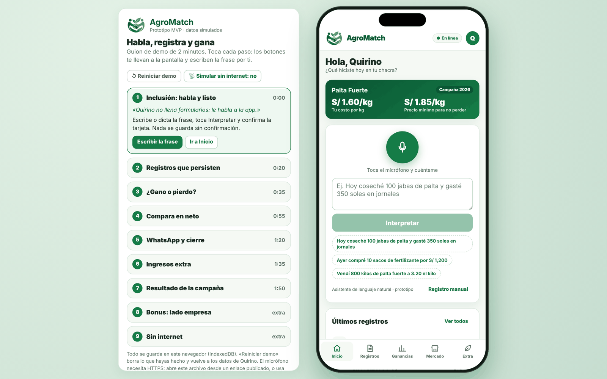
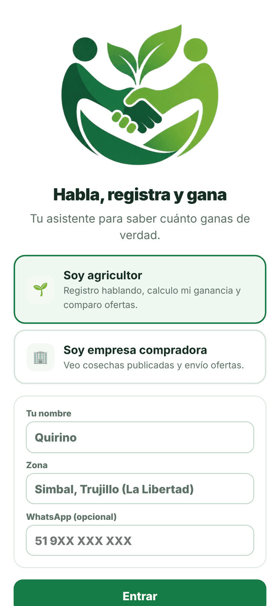
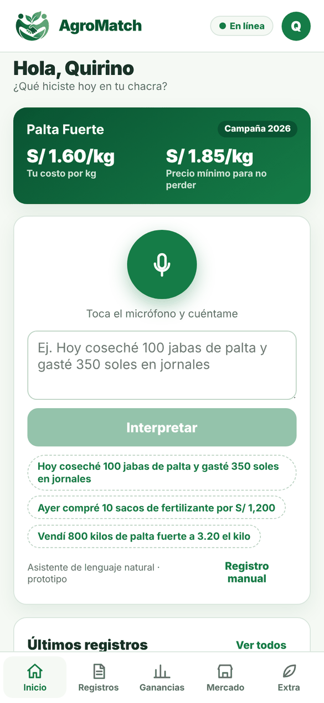
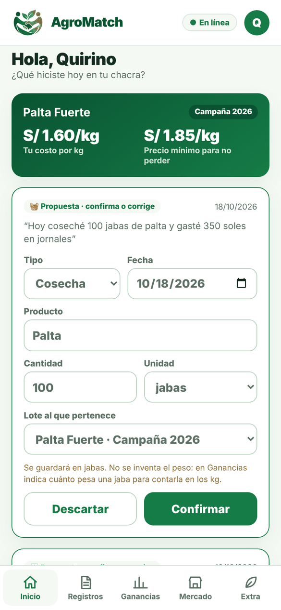
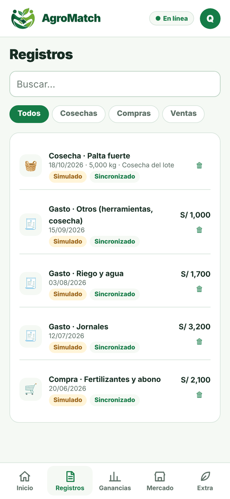
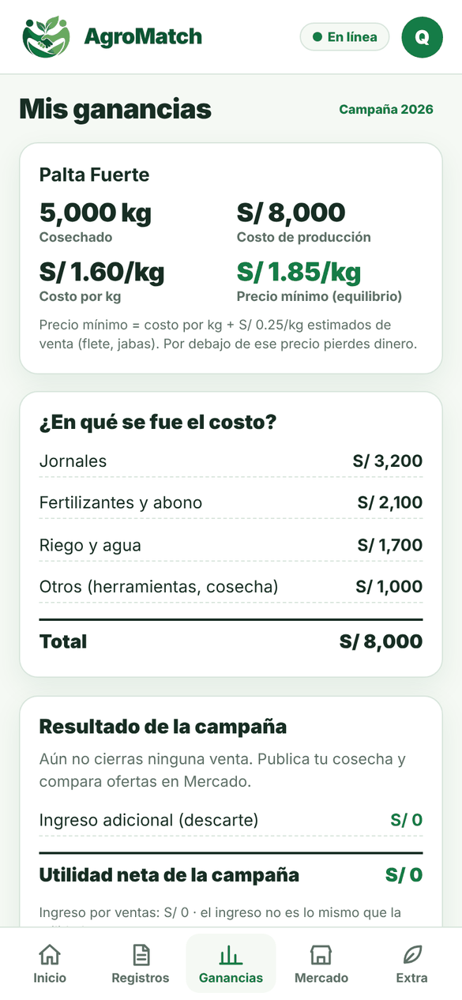
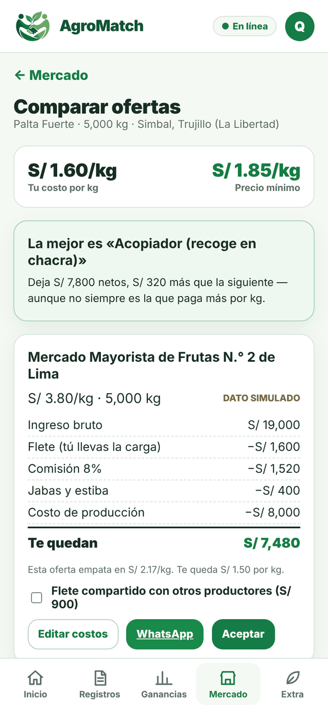
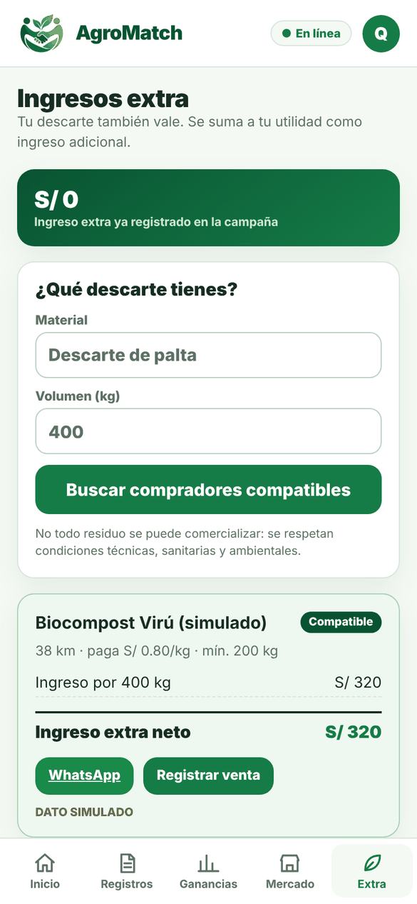
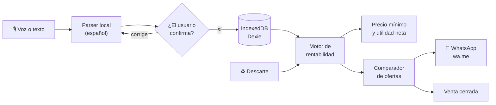

<div align="center">


# AgroMatch

**Habla, registra y gana.**
Asistente de rentabilidad e inclusión digital para pequeños productores agrícolas.

[](https://key-qr.github.io/agromatch/)
[](LICENSE)


*AGROTECH Challenge 2026 · UPN Trujillo · Perú Tech Week — Desafío 03: Inclusión tecnológica y rentabilidad para pequeños productores*

</div>

---



## El problema

El pequeño productor vende **"a ojo"**. No tiene calculado su costo por kilo, así que no sabe cuál es su precio mínimo y compara ofertas por el dato más visible y más engañoso: el precio por kilo.

Las herramientas digitales que existen asumen formularios, lectoescritura y conexión estable. En el campo peruano el **88,3 %** de los hogares rurales tiene celular, pero solo el **23,6 %** tiene internet en casa (INEI, ENAHO II-2025).

> **La oferta que paga más por kilo no siempre deja más ganancia.**
> En la demo, un mercado mayorista paga **S/ 3.80/kg** y al productor le quedan **S/ 7,480**. Un acopiador paga **S/ 3.20/kg**, recoge en chacra y le deja **S/ 7,800**. Sin un motor de costos, Quirino habría elegido la oferta equivocada.

## Funciones

| | Función | Qué hace |
|---|---|---|
| 🎙️ | **Habla y listo** | El productor dicta o escribe *"Hoy coseché 100 jabas de palta y gasté 350 soles en jornales"* y la app lo convierte en un registro estructurado (tipo, producto, cantidad, unidad, fecha, lote). Nada se guarda sin su confirmación. |
| 📒 | **Registros persistentes** | Cosechas, compras, gastos y ventas guardados en el dispositivo (IndexedDB). Sobreviven recargas y pérdida de señal. Filtros, búsqueda y edición. |
| 📊 | **¿Gano o pierdo?** | Desglose del costo de producción por lote, **costo por kg**, **precio mínimo** para no perder y utilidad neta de la campaña. |
| ⚖️ | **Comparador de ofertas** | Calcula lo que realmente le queda al productor por cada oferta, después de flete, comisión, jabas y costo de producción. Marca la mejor y muestra el precio de equilibrio de cada una. |
| 🚚 | **Flete compartido** | Simula dividir el flete con otros productores y recalcula en vivo cuál oferta conviene. |
| 💬 | **Contacto por WhatsApp** | Abre `wa.me` con el mensaje ya escrito. Es un enlace, no una integración que lee mensajes, y no tiene costo. |
| ♻️ | **Ingresos extra (economía circular)** | Busca compradores compatibles para el descarte (por material, volumen mínimo y distancia) y suma la venta a la utilidad de la campaña. |
| 🏢 | **Lado empresa** | Con el rol de empresa compradora (RUC de 11 dígitos) se ven las cosechas publicadas y se envían ofertas con sus costos. |
| 📡 | **Offline-first** | PWA instalable con service worker. El parser y todos los cálculos corren en el teléfono, sin servidor. |

## Capturas

<table>
  <tr>
    <td align="center" width="25%"><br /><sub><b>Bienvenida</b> · rol y perfil</sub></td>
    <td align="center" width="25%"><br /><sub><b>Inicio</b> · asistente por voz o texto</sub></td>
    <td align="center" width="25%"><br /><sub><b>Confirmación</b> · el usuario corrige y aprueba</sub></td>
    <td align="center" width="25%"><br /><sub><b>Registros</b> · guardados en el dispositivo</sub></td>
  </tr>
  <tr>
    <td align="center"><br /><sub><b>Ganancias</b> · costo/kg y precio mínimo</sub></td>
    <td align="center"><br /><sub><b>Comparador</b> · cuánto te queda de verdad</sub></td>
    <td align="center"><br /><sub><b>Ingresos extra</b> · el descarte también vale</sub></td>
    <td></td>
  </tr>
</table>

## Cómo funciona



### Las cuentas del motor

```
costo por kg      = costo de producción del lote / kg cosechados
precio mínimo     = costo por kg + gastos de venta estimados por kg
te quedan (neto)  = ingreso bruto − flete − comisión − jabas/estiba − costo de producción
```

Ejemplo con los datos de la demo (lote de palta Fuerte, 5,000 kg, costo S/ 8,000):

| Oferta | Precio | Ingreso bruto | Descuentos | **Te quedan** |
|---|---|---|---|---|
| Mercado mayorista (tú llevas la carga) | S/ 3.80/kg | S/ 19,000 | flete 1,600 · comisión 8 % 1,520 · jabas 400 | S/ 7,480 |
| Acopiador (recoge en chacra) | S/ 3.20/kg | S/ 16,000 | selección 200 | **S/ 7,800** ✅ |
| Mayorista con **flete compartido** | S/ 3.80/kg | S/ 19,000 | flete 900 · comisión 1,520 · jabas 400 | **S/ 8,180** |

Si el productor comparte el flete con otros productores, el mayorista pasa a ser la mejor opción. A eso se suman **S/ 320** por vender 400 kg de descarte a S/ 0.80/kg: la utilidad neta de la campaña queda en **S/ 8,500**.

## Decisiones de diseño

| Decisión | Por qué |
|---|---|
| **Parser local** en vez de depender de un LLM | Funciona sin internet en la chacra y no expone claves. Implementa un contrato (`interpretar`) que un LLM real puede cumplir más adelante sin rehacer la app. |
| **Confirmación obligatoria** | Nunca se guarda un registro que el usuario no aprobó. Si el parser no entiende, se abre el formulario manual. |
| **No inventar datos** | Si falta un dato, se pregunta. Si falta el costo, se muestra *"estimación incompleta"* en lugar de una ganancia falsa. |
| **IndexedDB con Dexie** | Los datos viven en el teléfono y hay una cola de sincronización preparada para la fase 2. |
| **`wa.me` en vez de la API de WhatsApp** | Costo cero y sin aprobación de Meta. |
| **Todo lo simulado va etiquetado** | Compradores, ofertas y publicaciones de la demo llevan la marca `DATO SIMULADO`. |

## Probar la demo

👉 **https://key-qr.github.io/agromatch/**

- **En el celular** se abre la app a pantalla completa y se puede instalar con *"Agregar a pantalla de inicio"*.
- **En la computadora** se ve el guion de 2 minutos al lado de la app dentro de un teléfono. Cada paso tiene botones que te llevan a la pantalla y escriben la frase por ti.
- El micrófono necesita HTTPS. En el link publicado funciona; si abres el HTML desde tu disco, usa *"Escribir la frase"*.
- *"Reiniciar demo"* borra lo que hiciste y vuelve a los datos de ejemplo.

## Correr en local

Requisitos: **Node.js 18+**

```bash
git clone https://github.com/Key-qr/agromatch.git
cd agromatch/agromatch
npm install
npm run dev          # http://localhost:5173
```

```bash
npm test             # pruebas unitarias (parser y motor) + integración (IndexedDB)
npm run build        # compilación de producción en dist/
npm run preview      # http://localhost:4173 — con service worker activo
```

> La PWA y el service worker solo se activan en la compilación de producción, no en `npm run dev`.

## Estructura del repositorio

```
.
├── agromatch/                 Código fuente de la PWA
│   ├── src/
│   │   ├── lib/
│   │   │   ├── parser.js        Lenguaje natural → registro estructurado
│   │   │   ├── rentabilidad.js  Costo/kg, precio mínimo, comparador, ingreso extra
│   │   │   ├── db.js            IndexedDB (Dexie) + cola de sincronización
│   │   │   ├── seed.js          Datos de demo marcados como simulados
│   │   │   ├── wa.js            Enlaces wa.me con mensaje prellenado
│   │   │   └── formatos.js      Moneda, fechas, unidades
│   │   ├── screens/           Onboarding, Inicio, Registros, Rentabilidad, Mercado, Extra, Perfil
│   │   ├── App.jsx            Navegación, encabezado, estado offline
│   │   └── ui.jsx             Componentes base
│   ├── scripts/               Pruebas unitarias y de integración
│   └── public/                sw.js, manifest, íconos
├── docs/                      Demo publicada con GitHub Pages (un solo HTML)
│   └── screenshots/           Capturas de este README
├── AgroMatch_v2_Alineado_Desafio3.md / .docx    Propuesta alineada al desafío
├── AgroMatch_Circular_Propuesta_y_Flujo_Hackaton.pdf
└── Desafio escogido.jpg
```

Más detalle técnico en [`agromatch/README.md`](agromatch/README.md), la justificación del proyecto en [`agromatch/FUNDAMENTACION.md`](agromatch/FUNDAMENTACION.md) y el guion del pitch en [`agromatch/DEMO_Y_PITCH.md`](agromatch/DEMO_Y_PITCH.md).

## Qué está simulado

- Compradores, publicaciones y ofertas.
- La "interpretación con IA" es un **parser determinístico en español**. Se presenta como asistente de lenguaje natural, no como un LLM.
- La sincronización entre dispositivos (Supabase) es **fase 2**. La demo corre en un solo dispositivo.

## Hoja de ruta

- [ ] Sincronización entre dispositivos con Supabase + RLS
- [ ] LLM opcional cuando hay conexión, sobre el mismo contrato `interpretar`
- [ ] Piloto con 50 productores de La Libertad, un cultivo y un material de descarte
- [ ] Métricas de impacto: variación de utilidad neta por lote, % de ventas sobre el precio mínimo y kg de descarte vendidos

## Licencia

Distribuido bajo la licencia **MIT**. Ver [`LICENSE`](LICENSE).

<div align="center"><sub>AgroMatch v2.0 · AGROTECH Challenge 2026 · Hecho en Trujillo, Perú 🇵🇪</sub></div>
